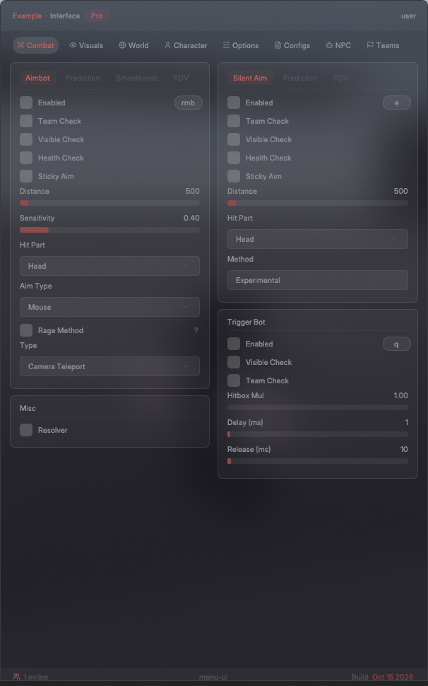
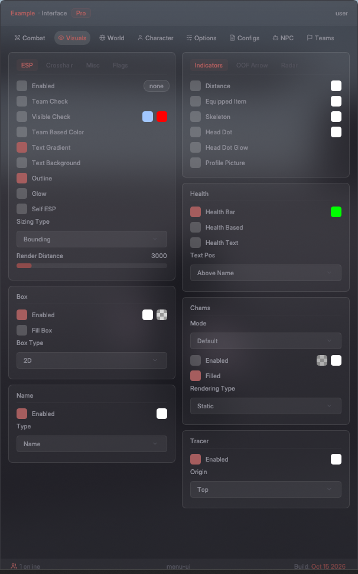

# matcha-ui

Unofficial recreation of the Matcha menu UI, made with Dear ImGui and DirectX 11. Not affiliated with Matcha.




It's only the UI. None of the options do anything.

The background is a live blur of whatever is behind the window, using the Windows compositor (Windows 10 and 11).

## Building

You need Windows, Visual Studio 2022 and CMake 3.20 or newer. Everything else is in `external/`.

```
cmake -B build
cmake --build build --config Release
```

The exe ends up in `build/Release/menu.exe`. Drag the window by any empty area.

## Layout

- `src/widgets.cpp` has all the controls and the panel layout
- `src/tabs.cpp` builds each tab out of those controls
- `src/gui.cpp` draws the title bar, tab row and footer
- `src/main.cpp` is the window and D3D11 setup

## Third party

- [Dear ImGui](https://github.com/ocornut/imgui) 1.92.9b, MIT
- [Inter](https://rsms.me/inter) 4.1, SIL Open Font License
- [Lucide](https://lucide.dev) icons, ISC
